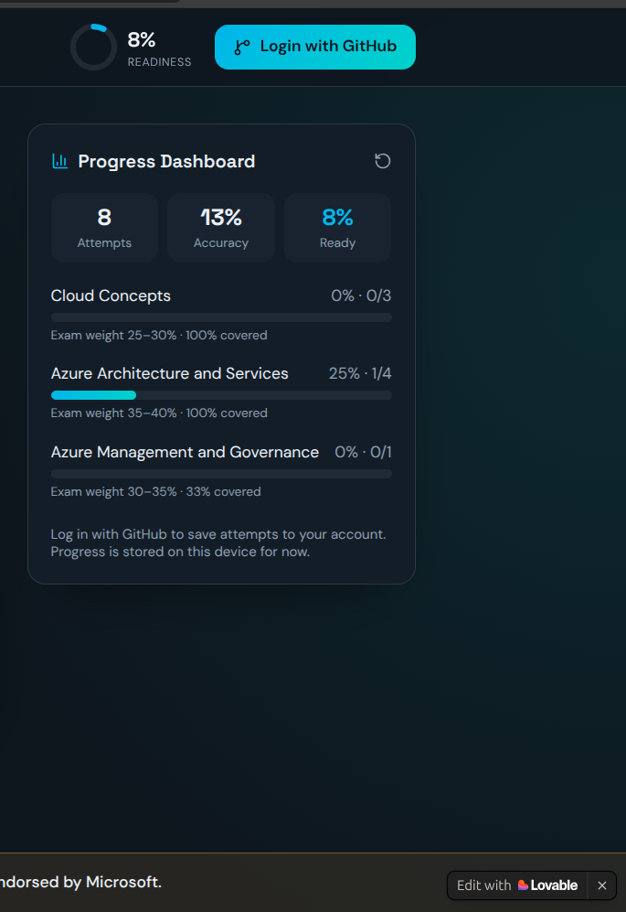
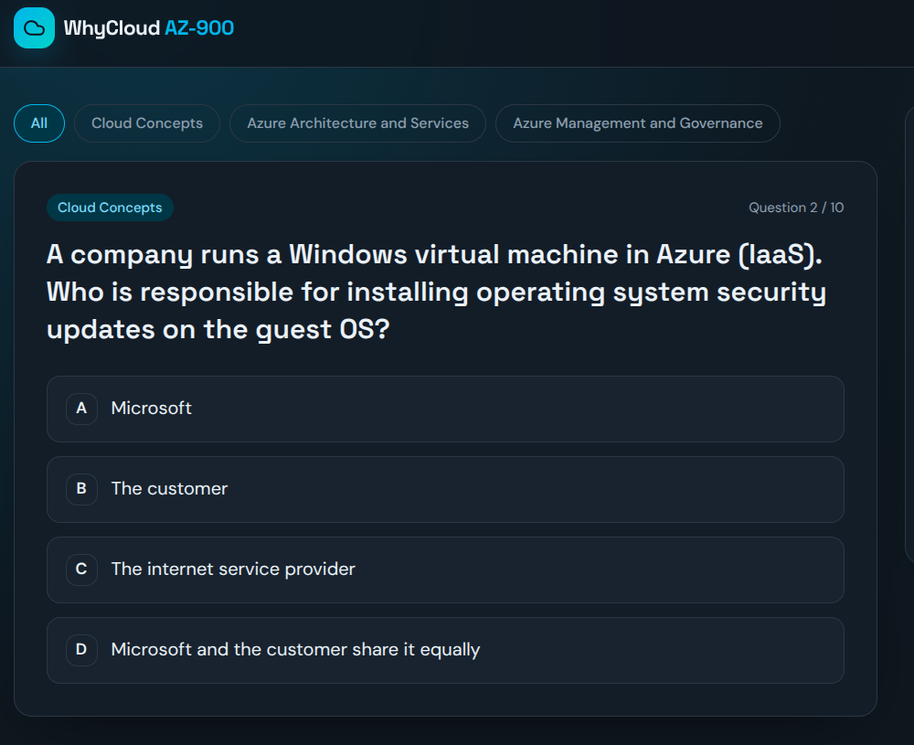
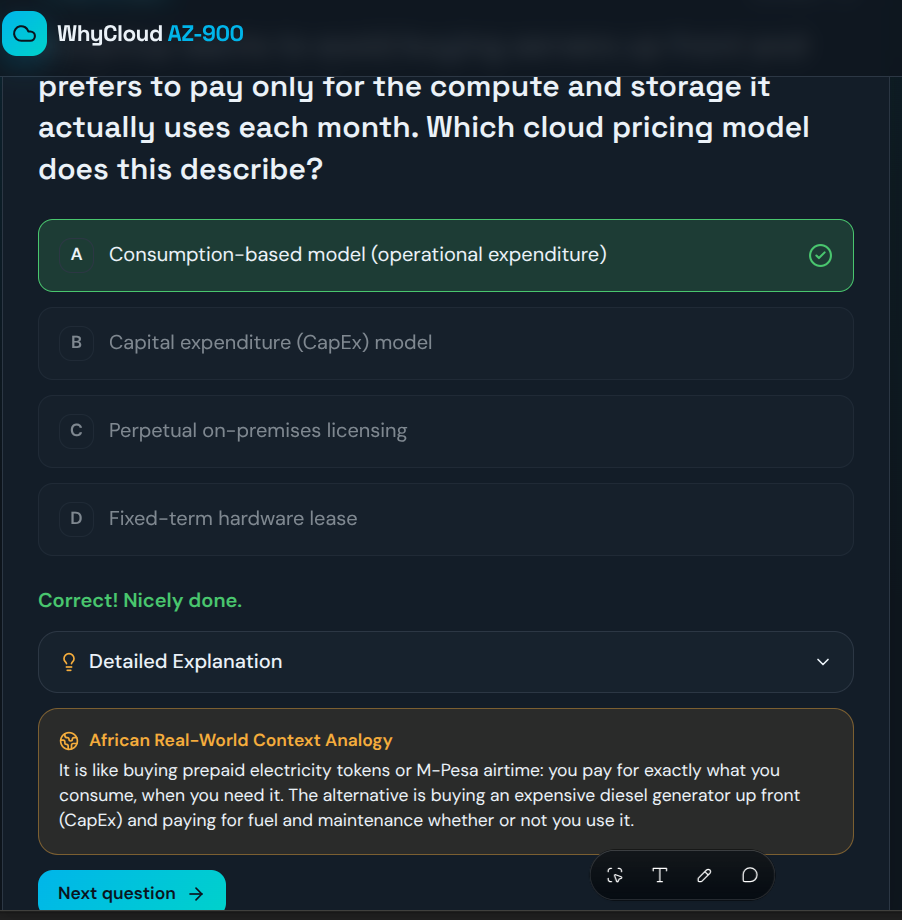

# WhyCloud AZ-900  ☁️

⚠️ **Unofficial study tool.** Not affiliated with, endorsed by, or sponsored by Microsoft.  
All questions are original and based on the public AZ-900 skills outline on [Microsoft Learn](https://learn.microsoft.com/en-us/certifications/exams/az-900). No real exam questions are used. No Microsoft logos are used.

Built for the **Vibe Coding Hackathon: AZ-900 Exam Prep Edition** by the **#1MillionDevs movement (Power Learn Project)**, 20–23 October 2026.  
*Hackathon theme:* Building Smarter Exam Prep Tools from Our Own Learning Journey.

---

## 🔗 Quick Links

* 🚀 **Live demo:** [https://cloud-vibe-cert-safari.lovable.app](https://cloud-vibe-cert-safari.lovable.app)
* 📂 **GitHub repo:** [https://github.com/B-m2005/whycloud-az900](https://github.com/B-m2005/whycloud-az900)
* 📘 **AZ-900 skills outline:** [Microsoft Learn](https://learn.microsoft.com/en-us/certifications/exams/az-900)
*  🎤 **Pitch deck:** [WhyCloud AZ-900 Pitch Deck](https://canva.link/d37vat8hhu8pzpr)

---

## 🎯 Challenges Addressed

WhyCloud tackles these hackathon problem statements:
- 📝 **Practice & Assessment: Smart Quiz Builder (primary):** a quiz app that gives instant feedback and a clear explanation for every answer, organised by AZ-900 topic.
- 📊 **Progress: Readiness Tracker:** a dashboard that tracks practice results by topic.
- 🤖 **Support: AI Study Buddy (partial):** every question includes a real-life African analogy that explains the concept in simple terms.

---

## 😖 The Problem

Many AZ-900 learners practise with standard flashcards or multiple-choice questions but still don't understand *why* an answer is right or wrong. Cloud concepts like CapEx vs. OpEx or shared responsibility can feel abstract and distant for beginners, and most study material uses examples that don't connect with everyday life in Africa. When preparing, technical jargon often created roadblocks before grasping the underlying logic.

---

## 💡 The Solution

WhyCloud explains the *why* behind every answer. After each question the learner sees:
1. Whether they were right or wrong, instantly.
2. A detailed explanation of why the correct option is right and why each wrong option is wrong.
3. An African analogy (such as M-Pesa airtime, market stalls, and village solar grids) that makes the concept instantly memorable.

---

## 👥 Target Users

- Beginners preparing for AZ-900, especially learners across Africa.
- Self-taught learners and students with little or no prior cloud background.
- #1MillionDevs cohorts and similar learning communities who want free, practical revision tools.

---

## ✨ Features

- **Domain-filtered quizzes:** Practise by specific AZ-900 domain or across all domains.
- **Instant feedback:** Immediate correct/incorrect response on every question.
- **Detailed explanations:** Clear context on why the right answer is right and why the others are wrong.
- **African analogies:** A relatable everyday scenario tied to every question.
- **Progress dashboard:** Tracks attempts, accuracy, and domain coverage (stored locally via browser storage and Supabase).
- **Dark mode interface:** Designed for clean, focused study sessions.

---

## 📚 Exam Domains Covered

Mapped to the public AZ-900 skills outline:

| Domain | Topics Covered in this Version |
| :--- | :--- |
| **Cloud Concepts** | Consumption-based pricing (CapEx vs. OpEx), shared responsibility model, elasticity |
| **Azure Architecture and Services** | Availability Zones, serverless compute (Azure Functions), resource hierarchy, private connectivity (ExpressRoute) |
| **Azure Management and Governance** | Azure Policy, resource locks, Total Cost of Ownership (TCO) calculator |

*Question bank: 10 original questions (3 / 4 / 3 across the domains above).*

---

## 🤖 AI & Prompt Engineering

Claude (`Claude.ai`) was used to generate and refine the question content, and act as a building assistant. Prompts were structured to be accurate and purposeful.

**Question-generation prompt summary:**
- **Role:** "Act as a Microsoft Certified Trainer for AZ-900."
- **Scope:** Questions covering Cloud Concepts, Architecture, and Governance, based strictly on public Microsoft Learn syllabus concepts.
- **Constraint:** "Do NOT copy actual exam questions."
- **Output format:** Strict JSON for direct application integration.

**JSON schema used for each question:**

```json
{
  "id": 1,
  "domain": "Cloud Concepts",
  "question": "...",
  "options": ["...", "...", "...", "..."],
  "correct_answer": "...",
  "explanation": "Why the correct option is right AND why the others are wrong",
  "african_analogy": "An everyday African scenario that mirrors the concept"
}
```

**Prompt design decisions:**
- Assigning a trainer **role** keeps the tone and difficulty aligned with a fundamentals-level exam.
- A **strict JSON schema** removes parsing bottlenecks and makes the content easily scalable.
- Requiring explanations for **wrong** options turns a basic quiz into a deep learning tool.
- A dedicated `african_analogy` field maintains consistent localization across all entries.

---

## 🛠️ Tech Stack & Tools

| Layer | Tool |
| :--- | :--- |
| **Frontend** | React, TypeScript, Tailwind CSS, Lucide Icons |
| **Build / Generation** | Lovable.dev, Vite |
| **Backend** | Supabase |
| **AI Assistance** | Claude.ai (Content generation and prompt engineering) |
| **Data Structure** | Structured JSON question bank |
| **Progress Tracking** | Client-side local storage / Supabase integration |

---

## 🚀 Getting Started Locally

Prerequisites: Node.js 18 or later and npm (or Bun).

```bash
# 1. Clone the repository
git clone https://github.com/B-m2005/whycloud-az900.git
cd whycloud-az900

# 2. Install dependencies
npm install
# or: bun install

# 3. Start the development server
npm run dev
# or: bun dev
```

Then open the local URL shown in your terminal (usually `http://localhost:5173`).

> If you use Supabase, add your own project keys to a `.env` file. Never commit real keys to GitHub.

---

## 📸 Screenshots

| Dashboard | Quiz Interface | Explanation View |
| :--- | :--- | :--- |
|  |  |  |

---

## 📈 Impact & Scalability

- **More learners:** A JSON-based question bank means anyone can contribute new questions without touching the code.
- **More certifications:** The same quiz engine and analogy format can support AZ-104, AI-900, DP-900, SC-900 and other certifications.
- **More languages:** The analogy field can be translated into Swahili, French, Hausa and other local languages.
- **More reach:** The app can grow into a mobile-friendly or offline-capable version for learners with limited connectivity.

---

## 🗺️ Roadmap

- [ ] Expand the question bank across all AZ-900 skills areas
- [ ] Add flashcards and spaced repetition for questions answered wrongly
- [ ] AI Study Buddy chat for follow-up questions
- [ ] Study planner based on exam date and weak areas
- [ ] Local-language support

---

## 👤 Team

- **Brian Nyakundi:** Builder. [GitHub: B-m2005](https://github.com/B-m2005)

---

## 📄 Disclaimer

WhyCloud AZ-900 is an **unofficial** educational project created for the #1MillionDevs Vibe Coding Hackathon. It is not affiliated with Microsoft. *Microsoft* and *Azure* are trademarks of the Microsoft group of companies. Practice questions are original and are not taken from the real exam. Passing these practice questions does not guarantee passing the certification exam. Always refer to [Microsoft Learn](https://learn.microsoft.com/en-us/credentials/certifications/azure-fundamentals/) for official study material.

---

*Let the vibes guide your code. Let your code help others succeed.* 🎧🔥
